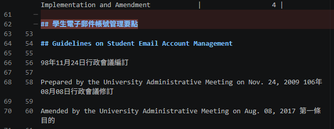
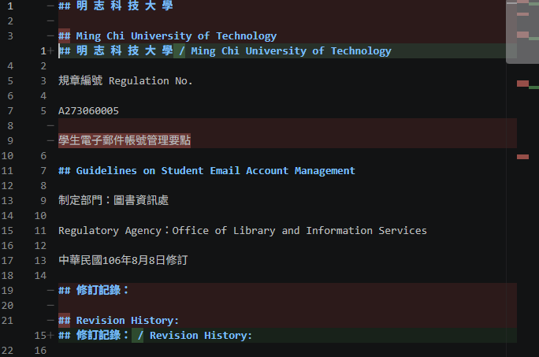
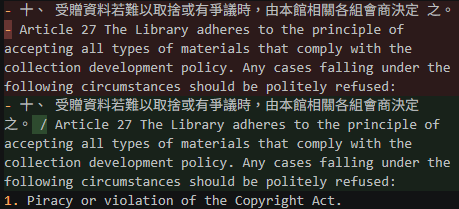
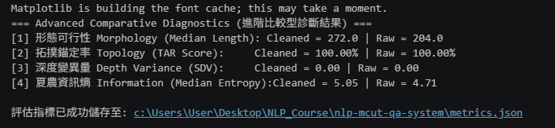

# 資料前處理報告 (Data Preparation Report)

> 期中評量 · NLP 自然語言處理 115-S1
> 填寫方式：請把所有「（ ）」與 `___` 替換成你自己的內容，並刪除 `>` 開頭的說明文字。

- **學號 / 姓名**：U12627028 / 曾瑋聖
- **專案名稱**：___
- **完成的任務**：- [ ] 1-A 頁首頁尾清除　- [ ] 1-B 雙語標題合併　- [ ] 1-C 雙語條文合併

---

## 1. 資料集概覽 (Dataset Overview)

> 數字來源：`01_Data_Ingestion.ipynb` 第 2 節 (掃描 PDF) 與第 5 節 (批次處理) 的輸出。

| 類別 (Cluster) | PDF 數量 | 清洗前 chunk 數 | 清洗後 chunk 數 |

| Library_Information | 3 | 248 | 225 |

| Academic_Affairs | 3 | 96 | 65 |

| Student_Affairs | 3 | 66 | 55 |

| **合計** | 9 | 410 | 345 |

**問題 (2–3 句)：** 清洗後 chunk 數量變少了多少？是哪個任務造成的？有沒有哪個任務**不影響** chunk 數量？為什麼？

清洗後共減少 65 個 Chunk，主要由任務 1-B 合併中英文標題造成。任務 1-A、1-C 通常不影響數量，因為程式只依照 ## 標題切塊。
> 提示：chunk 是用什麼規則切開的？請看 notebook 第 5 節的 `chunking_regex`。

___

## 2. 清洗步驟 (Cleaning Steps)

> **截圖來源：** `data/interim/<類別>/` 中的 `raw_*.md` (清洗前) 與 `cleaned_*.md` (清洗後)，也就是批次處理存下的**真實檔案**。
>
> **[重要] 不可使用 notebook 中的範例。** notebook 任務 1-A、1-B、1-C 的測試文字 (第二十一條、明志科技大學 / Ming Chi University of Technology、第十五條 / Article 15) **不能**作為你的截圖。請在真實檔案中**另找一處**，可以是其他 PDF 的檔案。使用範例的截圖**不給分**。
>
> **截圖方法 (VS Code 比較檢視)：**
> 1. 在檔案總管對 `raw_<檔名>.md` 按右鍵 → **Select for Compare**。
> 2. 對同一份文件的 `cleaned_<檔名>.md` 按右鍵 → **Compare with Selected**。
> 3. 左右並排顯示，紅色 = 刪除，綠色 = 新增或修改。按 `Ctrl + F` 搜尋，找到該任務造成的變更。
> 4. 每個任務截**一張**圖，存到 `reports/figures/`，**檔名必須完全相同** (否則圖片不會顯示)：
>    * 任務 1-A → `1a_compare.png`
>    * 任務 1-B → `1b_compare.png`
>    * 任務 1-C → `1c_compare.png`

### 2.1 任務 1-A：頁首頁尾溢出清除

- 檔名：cleaned_A273060005_學生電子郵件帳號管理要點
  
  搜尋的文字：學生電子郵件帳號管理要點
- 截圖 (存為 `reports/figures/1a_compare.png`)：
- 改變了什麼： 刪除了重複出現的文件名稱
- 這對之後的問答檢索有什麼幫助： 減少重複資訊，提升檢索準確性
- 這個任務有沒有**改錯**的地方 (把不該改的也改了)？若有，寫出檔名與搜尋的文字；若沒有，寫「沒有發現」：沒有發現
### 2.2 任務 1-B：雙語標題合併

- 檔名：cleaned_A273060005_學生電子郵件帳號管理要點
　
  搜尋的文字：明志科技大學
- 截圖 (存為 `reports/figures/1b_compare.png`)：
- 改變了什麼：將原本分開的中英文標題合併成同一行
- 這對之後的問答檢索有什麼幫助：保留中英文標題的對應關係，減少不必要的切塊，提高檢索準確性。
- 這個任務有沒有**改錯**的地方 (把不該改的也改了)？若有，寫出檔名與搜尋的文字；若沒有，寫「沒有發現」：沒有發現

### 2.3 任務 1-C：雙語條文合併

- 檔名：cleaned_A271010023_圖書館管理作業規範 
  
  搜尋的文字： Article 27
- 截圖 (存為 `reports/figures/1c_compare.png`)：
- 改變了什麼：將原本分開的中英文條文合併成同一段
- 這對之後的問答檢索有什麼幫助：保留中英文條文的對應關係，提高檢索準確性。
- 這個任務有沒有**改錯**的地方 (把不該改的也改了)？若有，寫出檔名與搜尋的文字；若沒有，寫「沒有發現」：沒有發現

## 3. 評估指標與 AI 解讀查證 (Metrics & Verifying the AI's Interpretation)

### 3.1 指標數據表

> 數字來源：專案根目錄的 `metrics.json`。[1]、[2] 必填；[3]、[4] 選填。
> 「參考值」由老師在課堂上公布 (完成全部任務的結果)。

| 指標 | Raw | Cleaned (你的) | Cleaned (參考值) |
|---|---|---|---|
| [1] 中位數長度 Median Length | 204 | 272 | 270.5 |
| [2] 拓撲錨定率 TAR | 100% | 100% | 100% |
| [3] 深度變異量 SDV (選填) | 0 | 0 | 0 |
| [4] 中位數資訊熵 Entropy (選填) | 4.71 | 5.05 | 5.06 |

> **儀表板截圖：** 你自己的 `01_Data_Ingestion.ipynb` **第 6 節**輸出的 4 拼圖儀表板 (第 8 週執行並保留的輸出)。截圖後存為 `reports/figures/dashboard.png`。第 3.2 節也會用到這張截圖。

你的 Cleaned 結果與參考值一致嗎？若一致，寫「一致」；若不一致，找出原因。（1 句）

大致一致。TAR 與 SDV 完全相同，中位數長度及資訊熵略有差異，可能是 PDF 解析或 Regex 清洗造成的切塊差異。
___

### 3.2 AI 的解讀

> 把第 3.1 節的儀表板截圖 (`dashboard.png`) 交給 AI，請它解讀結果。將 AI 的回答**完整貼在這裡**，並註明使用的 AI 工具。

- 使用的 AI 工具 : ChatGPT（GPT-6）

清洗後 Chunk 的中位數長度從 204 增加至 272 字元，代表零碎的切塊可能有所減少。TAR 維持 100%，SDV 維持 0，表示標題錨定率與深度變異量沒有改變。資訊熵從 4.71 提升至 5.05，代表文字的字元分布更加多樣。

整體而言，清洗後的 Chunk 結構有所改善，但仍可能存在過長、過短或表格格式錯亂的問題，需要人工進一步檢查。

### 3.3 你的查證 (至少兩點)

> 挑 AI 說得最肯定的兩句話，回到你的檔案或程式中找證據：它說的是真的嗎？

**查證 1**
- AI 的說法：清洗後 Chunk 的中位數長度從 204 增加至 272 字元
- 我查了什麼 (哪個檔案、哪個 chunk、哪段程式)： metrics.json 中的 Morphology_Median_Length 數據。
- 結論：正確，因為 Raw 為 204，Cleaned 為 272，與 AI 的說法一致。

**查證 2**
- AI 的說法：清洗後 Chunk 的資訊熵從 4.71 提升至 5.05，代表文字的字元分布更加多樣。
- 我查了什麼：metrics.json 中的 Information_Median_Entropy 數據。
- 結論：部分正確，因為資訊熵確實增加，但不能只憑資訊熵提高就認定 Chunk 的內容品質一定變好

### 3.4 實際證據：你被指定的 chunk

> 執行 `09_midterm_chunks.ipynb`：填入你的學號與老師在課堂上公布的 SEED，按 Run All。
> 每位同學拿到的 chunk 不同。請**連同驗證碼**一起填入。
> 程式只顯示前 400 字元的預覽。請在 VS Code 打開程式列出的**閱讀用檔案** (`data/interim/` 中的 `cleaned_*.md`，與 JSON 內容相同但有正常換行)，按 `Ctrl + G` 輸入程式給的**行號** (或按 `Ctrl + F` 搜尋「搜尋用」文字)，從該行讀到下一個 `## ` 標題為止，就是**完整**的 chunk。

- **SEED**：1106

**(a) 很長的 chunk**
- 資料檔 (JSON)：data/processed/Academic_Affairs/cleaned_A232020018_大學部學則_processed.json　位置：第 9 個 (從 0 開始數)　長度：7304 字元　驗證碼：23e93e33
- 閱讀用檔案 (`.md`)：data/interim/Academic_Affairs/cleaned_A232020018_大學部學則.md　從第 501 行開始
- 前 3 行內容：
  - 第四十二條 依規定辦理之各項學分班學生修習及格之專業課程，於入 學考試及格後，經申請核准抵免學分，得依「學生抵免學 分辦法」採計為畢業學分。 / Article 42 Upon passing the entrance examination, students in creditbearing programs who have completed and passed the professional courses in accordance with the regulations of the University shall be allowed for credit transfer upon approval of their application, and such credits shall be counted as graduation credits in accordance with the Regulations Governing the Credit Transfer.
  
    第四章 請假、休學、復學、退學 / Chapter 4 Excused Absences Leaves of Absence (Suspension), Resumption of Studies, and Withdrawal
  
- 這是什麼樣的文字？為什麼會這麼長？ 這是「大學部學則」第四章關於請假、休學、復學及退學的中英雙語法規條文，因為程式只依照章節標題切塊，沒有將各個條文分開，導致多項法規內容合併在同一個 Chunk 中。
- 之後做問答檢索時，這麼長的 chunk 可能造成什麼問題？Chunk 過長會包含太多不同條文，可能降低問答檢索的準確性，讓 AI 難以找到正確答案，也會增加處理時間。

**(b) 資訊熵很低的 chunk**
- 資料檔 (JSON)：data/processed/Library_Information/cleaned_A271010023_圖書館管理作業規範_processed.json位置：第 22 個 (從 0 開始數)　資訊熵：3.03　驗證碼：fe378165
- 閱讀用檔案 (`.md`)：data/interim/Library_Information/cleaned_A271010023_圖書館管理作業規範.md　從第 259 行開始
- 內容：
  criticism.
- 為什麼它的資訊熵這麼低？它對問答檢索有用嗎？(因為只有## criticism.)13 個字元，內容缺乏完整資訊，因此缺乏完整的條文內容與上下文，無法提供足夠資訊來回答問題。

## 4. 一個尚未解決的問題 (One Remaining Problem)

> 打開 `data/interim/` 中任一個 `cleaned_*.md` (與 `data/processed/` 的 JSON 內容相同，但有正常換行，比較好讀)，找出一個清洗後**仍然有問題**的 chunk。
> 每個 chunk 從一個 `## ` 標題開始，到下一個 `## ` 標題之前結束。
> 例如：只有標題沒有內文、表格亂掉、中英文沒有對齊、還有殘留的頁首頁尾、斷行造成的多餘空白，或是**清洗造成的錯誤** (誤合併、誤刪除)。
> **不可**使用第 3.4 節的兩個 chunk。

- **檔名** (`cleaned_*.md`)：cleaned_A231060004_學生申請期中停修課程實施要點.md　**從第 62  行開始** (VS Code 左側的行號)　
  
  **標題**：明志科技大學 期中停修申請表
- **我是怎麼找到的** :閱讀清洗後的 Markdown 時，發現期中停修申請表的表格格式不正常，原本應該分開的欄位被合併在一起
- **問題 chunk (貼上部分內容)**：
| 課程 名稱 學分數 授課 教師 編號 01 02 03 04 05 06 07 08 09 10 11 12 13 14 15 教 務 長   |
|-----------------------------------------------------------------------------------------|

- **問題是什麼**：原本應該分開的表格欄位被合併成同一行
- **可能的原因** (PDF 本身？Docling 轉換？清洗的正則表示式？切塊規則？)：Docling 在 PDF 轉換成 .md 時，未能正確辨識表格的欄位與結構，且 Regex 清洗沒有修復此問題。
- **具體的修正方法** (例如：一條規則、一個正則表示式的構想、長度上限)：  
可以新增一條表格格式檢查規則，當表格只有一欄卻包含多個欄位名稱時，將其標記為異常，再依照原始 PDF 重新分割欄位，恢復正確的表格結構
- **對問答檢索的影響**：表格資訊混在一起，可能讓 AI 無法正確理解各欄位的內容，降低問答檢索的準確性。

## 5. AI 協作 (AI Collaboration)

- 本次作業的 AI 協作紀錄請見 [`AI_USAGE.md`](AI_USAGE.md) 的「Week 04 / 08」與「Week 09」段落。
- 這次使用 AI 最大的收穫或教訓是 這次使用 AI 最大的收穫是學會分析 Chunk 的品質，並了解即使經過 Regex 清洗，仍可能出現表格錯亂或內容過長等問題，不能完全依賴 AI，還需要自己檢查與判斷。
